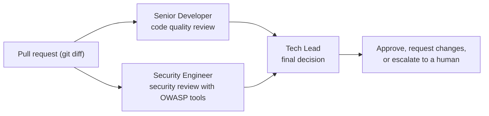

# Multi-Agent Code Reviewer (CrewAI)

A Python multi-agent system, built with [CrewAI](https://www.crewai.com/), that reviews a pull request for code quality and security, then decides whether to **approve**, **request changes**, or **escalate to a human**.

These notebooks come from the first two modules of the DeepLearning.AI course [Design, Develop, and Deploy Multi-Agent Systems with CrewAI](https://www.deeplearning.ai/courses/design-develop-and-deploy-multi-agent-systems-with-crewai). It is a learning project and prototype, not a production tool.

## What it does

Instead of one large prompt, the review is split across three specialized AI agents:

| Agent | Responsibility | Tools |
|---|---|---|
| **Senior Developer** | Reviews style, bugs, and maintainability. Separates critical issues from minor ones. | None |
| **Security Engineer** | Finds vulnerabilities, rates their risk, and decides whether they block approval. | Serper search (limited to owasp.org) and a website scraper |
| **Tech Lead** | Reads both reports and makes the final call: approve, request changes, or escalate. | None |

The tasks run in order: quality review, security review, final decision. The Tech Lead receives the first two reports as context.

## Files

| File | What it covers |
|---|---|
| `C1M1_Assignment.ipynb` | **Module 1: build the crew.** Three agents, three tasks, OWASP search and scraping tools, and a sequential crew. Includes a saved run on a sample pull request. |
| `C1M2_Assignment.ipynb` | **Module 2: make it more reliable.** Adds Pydantic-validated JSON output, two guardrails, a before-kickoff hook that reads the PR file, crew memory, and YAML-based configuration. Shows the code only, without a saved crew run. |

## Concepts used

- **Agents, tasks, and crews** in CrewAI, with task `context` to pass one agent's findings to another
- **Tools** that let an agent search and read web pages
- **Pydantic models** to force LLM output into a fixed JSON structure
- **Guardrails**: Python functions that validate an agent's answer. If a check fails, the error goes back to the agent so it can try again.
  - Security guardrail: every risk level must be `low`, `medium`, or `high`, and `highest_risk` must match the vulnerabilities listed
  - Decision guardrail: the final report must contain `approve`, `request changes`, or `escalate`
- **Execution hook** that loads the PR file before any agent runs, since reading a file does not need an LLM
- **Memory**, so the crew can remember issues from earlier pull requests

## Example result (from Module 1)

**Input:** a diff to `authenticate_user()` that adds login timestamps, print-based logging, and a logout function, while still building SQL queries with f-strings and comparing passwords directly.

**Result:**
- **Senior Developer** flagged the SQL injection risk and the unprotected password comparison as critical issues.
- **Security Engineer** rated the SQL injection as critical and read OWASP's SQL Injection Prevention cheat sheet to support its recommendations.
- **Tech Lead** decided **Request changes**: use parameterized queries, hash passwords (for example with bcrypt), and replace `print` statements with a logging library.

LLM output varies between runs, so exact wording will differ.

## Tech stack

Python, CrewAI 1.3.0, `crewai-tools` (`SerperDevTool`, `ScrapeWebsiteTool`), OpenAI `gpt-4o-mini`, Pydantic, PyYAML, Jupyter

## Running the notebooks

The notebooks were completed in the DeepLearning.AI course environment and rely on course files that are not included here (`utils.py`, `unittests.py`, `config/agents.yaml`, `config/tasks.yaml`, and the sample PR file). They will not run as-is on another machine. They are shared to show the code and the Module 1 output.

To run something similar yourself:

1. Install the libraries: `pip install "crewai[tools]==1.3.0" pyyaml jupyter`
2. Set `OPENAI_API_KEY` and `SERPER_API_KEY` as environment variables
3. Add your own agent and task YAML files, a PR diff file, and replace the course helper imports

## What I learned

- Splitting a task into specialized roles gives more focused, easier-to-debug results than one large prompt.
- Guardrails and Pydantic models make LLM output predictable enough to build on.
- Not every step needs an agent. Reading a file is plain code, so it belongs in a hook.

## Acknowledgements

Based on the Module 1 and Module 2 assignments ("Automatic Code Review" and "Adding Functionality to Automatic Code Review Crew") from [Design, Develop, and Deploy Multi-Agent Systems with CrewAI](https://www.deeplearning.ai/courses/design-develop-and-deploy-multi-agent-systems-with-crewai) by DeepLearning.AI, taught by João Moura, founder and CEO of CrewAI. The course content and original assignment design belong to DeepLearning.AI and CrewAI. This repository is not affiliated with or endorsed by either.

## Author

**Niharika Dhapola**
[LinkedIn](https://www.linkedin.com/in/niharika-db/) · [GitHub](https://github.com/niharikadhapola)
